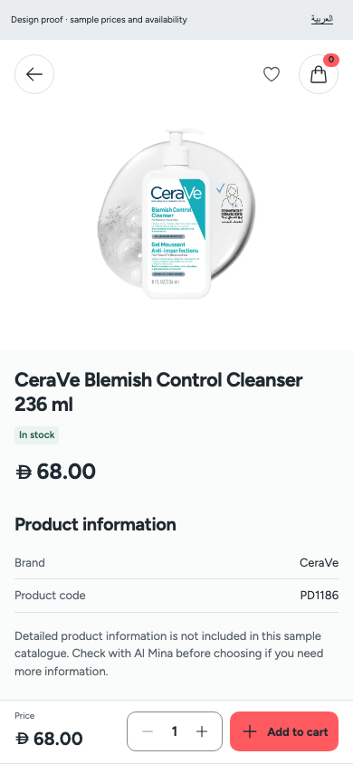
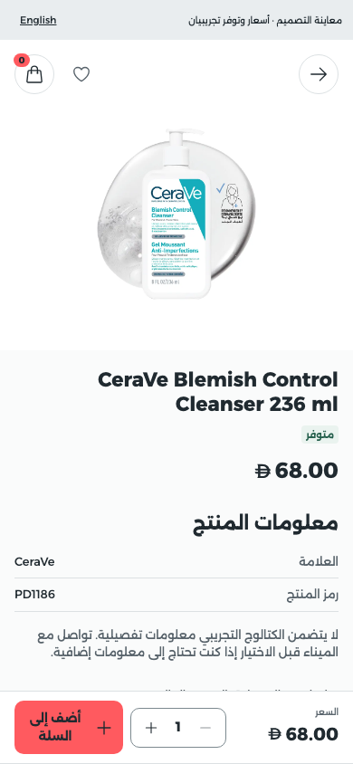

# P1-05 — N03 image-first PDP correction

17 November 2026, starting `058d1d5`, clean focused branch. **Latest revision for owner review; supersedes the separate toolbar-bar preview.** Owner retained A/full-width desktop home, five wide-screen columns and the shown supporting system. No final DESIGN.md/token/shared-style switch or deployment.

## Owner request and interpretation

Owner rejected the preceding toolbar preview and requested `03-green-pharmacy-screens.jpg`: “top full for image etcc also other aspects.” [Reference N03](../../../../../docs/design/storefront/references/2026-11-17/03-green-pharmacy-screens.jpg) is therefore the current **mobile PDP composition** reference. It does not override the owner's selected home A, Figtree/Alexandria or coral identity.

**Implemented interpretation:** full-width uninterrupted product-image surface, lightweight Back/Save/Cart controls over the image, no standalone toolbar/title row or phone browse header; compact title/stock/price below; related products as a compact horizontal mobile rail. Existing persistent buying access is retained from the owner's prior explicit request. Reference green, fabricated ratings/reviews, medicine copy, camera/bell controls, device frame, watermark and delivery/discount claims are excluded. A single real image has no fabricated carousel dots. Available matching SKU/image relationships remain functional.

## Working revision

[Open current mobile PDP](http://127.0.0.1:4870/design-proof/products/sample--PD1186). [Selected home A/five](http://127.0.0.1:4870/design-proof?lead=full&columns=5). Port 4860 remains the incumbent site.

[320px Arabic](p1-05-image/pdp-narrow-ar.png), [preserved desktop](p1-05-image/pdp-desktop-en.png), [related rail EN](p1-05-image/related-phone-en.png), [related rail AR](p1-05-image/related-phone-ar.png). [Eight capture records/hashes](p1-05-image/capture-manifest.json).

## Implementation and verification

- Phone gallery spans the available viewport width with square outer edges and an unbroken white surface that respects original source-photo backgrounds. No edited/generated product packaging. Controls are 44px, labelled, keyboard accessible and mirrored appropriately for Arabic. Gallery controls scroll with the image instead of occupying a sticky toolbar strip. Review-only sample/language notice remains above the image; it is not planned production chrome.
- Existing sanitized Back/results/scroll/focus behavior, actual save/cart counts, stock revalidation, quantity controls and buying dock remain. Short landscape retains its existing in-flow purchase fallback. Safe-area hooks apply to overlay controls and buying content; physical notch/keyboard behavior remains unverified.
- Product title and price hierarchy tightened; related rail scrolls locally with compact cards and intact purchase targets. Desktop, home, listing, customer/admin/wholesale themes, routes and server actions remain unchanged.
- **17 existing proof interaction tests pass**, including EN/AR overlay Back/Cart, 320/390/768 layout and target checks, full-width gallery bounds, live desktop-search → phone resize, query/scroll/focus return, native Back, stock rejection, family/gallery switching and retry/storage cases. Prior sticky-toolbar assertion was replaced because the owner requested controls over the image, not a separate sticky header. Intentional injected catalogue failure logs are expected test cases.
- Web typecheck, root lint and fresh isolated production build `.next-verification-p1-image` pass. Six top-of-page EN/AR phone/narrow/desktop captures have HTTP 200, no document overflow or browser page errors; two related-rail captures retained. Direct rendered inspection covered the new phone/RTL/narrow composition and lower rail. Final adjustment blends the real photo background with the gallery and aligns overlay control insets; no commerce logic changed.
- Previous P1-04 admin/checkout/shared responsive evidence remains historical for untouched consumers; no repeat of that harness or independent review claimed. No order submitted, provider/database access or deployment. Native devices, actual software keyboard, speech, browser zoom and other engines remain unverified.

Raw logs under `.verification-results/storefront-replacement/p1-05-image/` are ignored. Test/capture browser processes closed; normal 4870/4871 and original 4860/4861 preserved. Generated next-env build noise restored.

**Status:** owner-selected A/five/supporting system remains settled. This N03-based mobile PDP replaces the rejected toolbar candidate and awaits owner review before P1-05 closes/P2 begins. Record requested corrections or acceptance against these revised captures; do not restore the rejected standalone toolbar or infer final-system approval from code completion.
