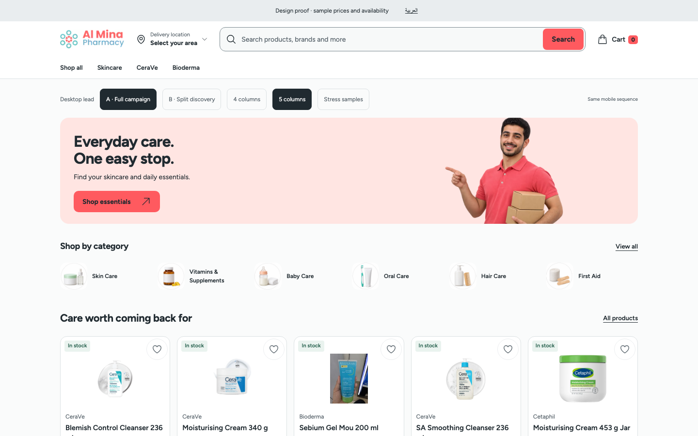
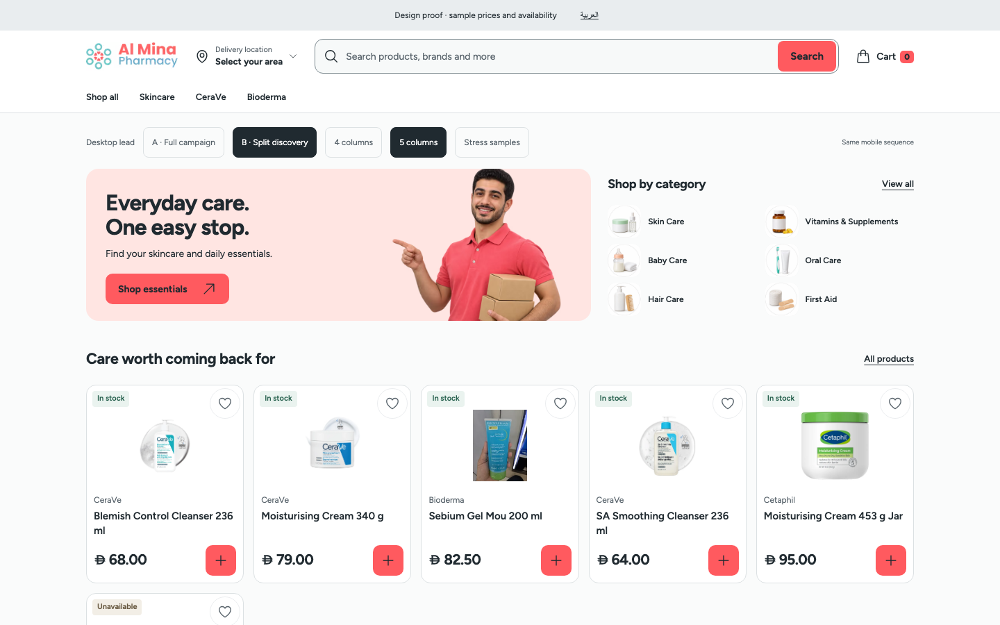
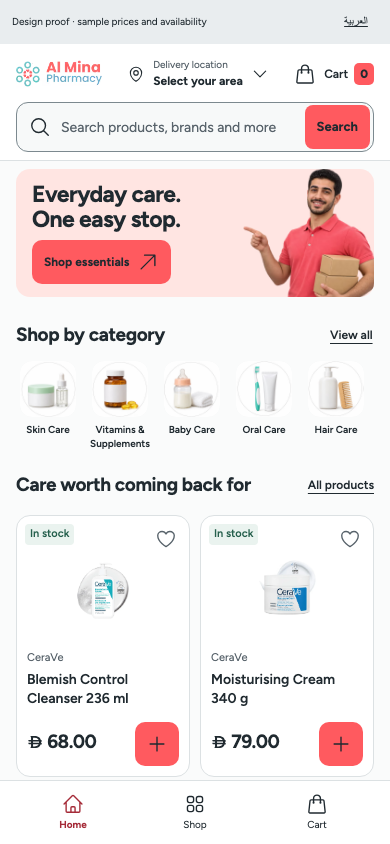
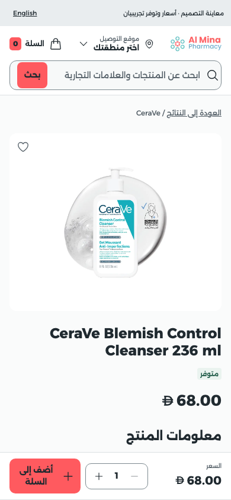

# P1-05 — screen selection for the replacement storefront

> Historical comparison evidence. The live proof routes and launch commands were retired in [P6-01](p6-01-retirement.md). Captures and the recorded screen decisions remain available.

> **Latest status:** Owner rejected the standalone toolbar; [N03 full-image PDP correction](p1-05-image.md) supersedes that preview. A/five and the shown supporting system remain selected. Read the latest correction for current review state.

> **Subsequent owner response:** Selected **A/full-width campaign + five wide-screen home columns**, retaining the shown supporting system. Earlier B recommendation below is historical and superseded. Requested compact phone PDP toolbar preview is [implemented and captured separately](p1-05-toolbar.md); only that revision awaits review. Original captures below intentionally retain source b541e42, before the correction.

17 November 2026. Runtime source `b541e42`, branch `codex/storefront-pharmacy-app-reference`. **Awaiting owner review.** This packet records proposals and concrete screens; it is not a final DESIGN.md, token system, acceptance record or release approval. [Phase 1's screen-selection gate](../implementation-phases.md#phase-1--comparable-coded-direction-proof) requires an owner decision before P2.

## Recommendation and decision

**Recommend B: split desktop lead, five home columns at the demonstrated wide size, shared mobile/listing/PDP, with the supporting system shown here.** Search stays prominent; campaign and categories share a row; merchandise is reachable earlier. This is a recommendation, not a selection on the owner's behalf. Four columns remain the listing layout beside its filter rail. Responsive layouts continue to reduce columns; five is not a tablet/phone mandate.

A valid response can be “B with the proposed system,” “A with the proposed system,” or named corrections. A different density can be specified independently. Accepting the direction does not accept incomplete content, unverified devices or deployment. If corrections materially change the screens, recapture them and record the response before entering P2.

| Decision | Confirmed already | Candidate awaiting this review |
| --- | --- | --- |
| Brand and colour | Actual logo; primary exactly #FF5A5F | Quiet near-white/ink support, dark labels on coral, subdued campaign tint, logo aqua confined to identity and purposeful secondary use; independent stock/saved/error/selection roles. |
| Typography | Readable EN/AR, RTL, full identities, accessible controls | Figtree / Alexandria as rendered, compact hierarchy and weights. Existing licensed fonts were evaluated deliberately, not accepted solely because installed. |
| Desktop lead | Deliberate desktop, search priority, useful discovery | A full campaign above category lane versus B campaign beside categories. Recommend B. |
| Density | Compact useful information, no clipped facts, 44px targets | Recommend five home columns at 1440px; compare four independently. Listing four beside sidebar. Phone two-column cards/rail as shown. |
| Shapes and feedback | Clear keyboard focus and states, persistent mobile buying | Quiet bordered cards, round save controls, compact rounded-rectangle purchase/search controls, limited overlay shadow. No universal pill treatment. |
| Mobile and PDP | App-like tasks, search-led browse, image-first PDP and sticky buying, reference 02 priority | Shared candidate below: browse context plus search, small photographic campaign, circular categories; actual image, identity/price/options then purchase dock. Contextual PDP toolbar remains a possible correction, described below. |

Exact support values in the prototype module remain implementation evidence until accepted screens are translated into P2's primitive → semantic → component roles. This review does not elevate every prototype measurement or hardcoded value into a permanent rule.

## Desktop: compare one variable at a time

All four cases use the same six records/order, prices/stock, photography, copy, typography, header and controls. These are compositions within one direction, not four competing identities. Both leads converge to the same mobile sequence.

| Lead / density | Working coded preview | Current English capture | Current Arabic capture |
| --- | --- | --- | --- |
| A full campaign, four | [Open A4](http://127.0.0.1:4870/design-proof?lead=full&columns=4) | [EN A4](p1-05-selection/home-full-4-en.png) | [AR A4](p1-05-selection/home-full-4-ar.png) |
| A full campaign, five | [Open A5](http://127.0.0.1:4870/design-proof?lead=full&columns=5) | [EN A5](p1-05-selection/home-full-5-en.png) | [AR A5](p1-05-selection/home-full-5-ar.png) |
| B split discovery, four | [Open B4](http://127.0.0.1:4870/design-proof?lead=split&columns=4) | [EN B4](p1-05-selection/home-split-4-en.png) | [AR B4](p1-05-selection/home-split-4-ar.png) |
| B split discovery, five | [Open B5 — recommended](http://127.0.0.1:4870/design-proof?lead=split&columns=5) | [EN B5](p1-05-selection/home-split-5-en.png) | [AR B5](p1-05-selection/home-split-5-ar.png) |

At 1440×900, first home purchase action ends at **Y969 EN / Y990 AR for A**, versus **Y829 EN / Y850 AR for B**, at both tested column choices. The **140px improvement comes from the lead**, not adding a fifth column. Five increases visible product variety; four gives names/photos more room. This is viewport/fixture geometry, not conversion evidence or a universal fold promise. Reference N04/N06/N07's merchandise rhythm supports the compact retail approach; their huge “Pharmacy” display, service panels and many competing campaign colours are excluded.

**A — full campaign, five columns**

**B — split discovery, five columns, recommended**

## Shared mobile, listing and product detail

[Open home](http://127.0.0.1:4870/design-proof), [listing](http://127.0.0.1:4870/design-proof/products), [actual-product PDP](http://127.0.0.1:4870/design-proof/products/sample--PD1186). Use the preview's language switch for Arabic. Port **4860 is the incumbent**, not these replacement screens.

| Screen | English | Arabic | Review focus |
| --- | --- | --- | --- |
| Phone home | [EN](p1-05-selection/home-mobile-en.png) | [AR](p1-05-selection/home-mobile-ar.png) | Wide search; bounded photographic ad; categories; full first card purchase access above labelled navigation. |
| Phone listing | [EN](p1-05-selection/listing-mobile-en.png) | [AR](p1-05-selection/listing-mobile-ar.png) | Compact identities, stock, save, dirham, quantity/add; filter/sort and query remain usable. |
| Phone PDP | [EN](p1-05-selection/pdp-mobile-en.png) | [AR](p1-05-selection/pdp-mobile-ar.png) | Image-first buying hierarchy and sticky purchase; absent description remains honest. |
| Desktop listing | [EN](p1-05-selection/listing-desktop-en.png) | [AR](p1-05-selection/listing-desktop-ar.png) | Four columns beside filters, readable names/prices, consistent action alignment. |
| Desktop PDP | [EN](p1-05-selection/pdp-desktop-en.png) | [AR](p1-05-selection/pdp-desktop-ar.png) | Gallery/buying columns; facts and related content; actual single image has no fake carousel. |

## Reference interpretation — explicit versus proposed

The owner's words establish search priority, card compactness/dirham, reference 02 home/PDP priority, persistent buying access and a complete desktop. The adaptations below are design judgments for review; screenshot-only gestures, promises and services are not established behavior.

| Reference | Borrow shown in coded screens | Avoid / deliberate adaptation | Unknown / difference requiring attention |
| --- | --- | --- | --- |
| [02 pharmacy app](../../../../../docs/design/storefront/references/02-pharmacy-app.png) | Search → photographic ad → circles → products; large product image before buying sequence. | Al Mina identity/coral; factual stock/pack/prices. No blue brand, scanner, fabricated reviews/discount, chat, device frame or watermark. | Reference has a very compact PDP back toolbar; current proof keeps search/context above the gallery. **If a closer app-style PDP is required, select this correction before P2; it needs a revised capture.** Reference images do not prove back, variant or checkout behavior. |
| [Compact product card](../../../../../docs/design/storefront/references/05-product-card.png) | Stock/save corners, product image, brand and identity, prominent dirham price, reachable add/quantity. | No copied ratings or made-up pack tags. Product name carries verified size where available. Brand prefix deduplicated visually, accessible full identity retained. | Better exact-pack photography remains a content dependency; one fixture photo is handheld. No guessed review totals. |
| [N01 teal mobile](../../../../../docs/design/storefront/references/2026-11-17/01-teal-mobile-home-pdp.jpg) | Location/search grouping, ordered browsing, bottom purchase/task hierarchy. | No teal competing primary, dark floating tab bar, pet content, seller chat or 360° claim. | Native tab persistence/360° gestures not established by reference or certified by proof. |
| [N02/N03 green pharmacy](../../../../../docs/design/storefront/references/2026-11-17/03-green-pharmacy-screens.jpg) | Compact promotion, early categories/merchandise, straightforward buying. | No onboarding detour, huge greeting/header, prescription/medical/delivery claims or green replacement brand. | Actual recommendation logic/availability/services cannot be inferred from screenshots. |
| [N05 search/discovery](../../../../../docs/design/storefront/references/2026-11-17/05-teal-mobile-search-discovery.jpg) | Prominent search and location, category scanning, bounded banner. | No oversized input/blank gaps, invented microphone/scanner/prescription service or discount promise. | Actual voice/search/location logic is not shown; use tested existing contracts. |
| [N04/N06/N07 desktop family](../../../../../docs/design/storefront/references/2026-11-17/07-desktop-commerce-detail.webp) | Restrained merchandising grids, category/brand discovery rhythm, useful section actions, intentional desktop columns. | No giant headline, unsupported consultations/reviews/app links/free delivery, multicolour template collage or unrelated brands. | Reference content cadence is not an Al Mina requirement. Current six-product proof is not a finished merchandising homepage. |

## What this decision does and does not settle

Accepting the direction permits final system work in P2 using the accepted screen structure/type/colour/shape/density decisions. It does not make the current prototype a complete production storefront. P3–P6 still own full navigation/home/footer content, production catalogue and PDP migration, cart/customer/checkout UI, old-style retirement and final verification.

- Prototype comparison controls/sample notice are review tools, excluded from production composition.
- Generated campaign art and category images remain candidate assets with prior provenance; final content/rights/campaign cadence need resolution. No reference screenshot is a public storefront asset.
- Actual product imagery is preserved; photo quality and consistent exact-pack treatment still need a factual media workflow. Never generate substitute medicine packaging.
- Shared/admin/wholesale isolation and incumbent error/404/continuity findings remain open. No old shared styles removed here.
- P1-04 demonstrates search/back/cart/retry and SKU/media relationships; account is an explicit contract screen, checkout is unavailable in the proof. Enabled server quote/review was tested separately without submitting an order.
- Native devices/software keyboard/screen reader/zoom, real provider readiness and end-to-end release verification remain later work. No conversion or production-readiness claim.

## Capture/checkpoint record

Eighteen fresh viewport captures from **b541e42** in [manifest](p1-05-selection/capture-manifest.json): both languages, all four desktop lead/density combinations, shared phone home/listing/PDP, desktop listing/PDP. All 200, no document overflow or browser page errors observed; fonts and source images settled before capture. Only Next development diagnostics hidden for presentation. No app/source/styles/dependencies changed and no build/test rerun needed for this documentation/capture task. Prior [P1-03](p1-03-density.md) and [P1-04](p1-04-modes.md) verification boundaries remain intact. Temporary capture browser closed; original and proof preview processes preserved.

**Owner decision: pending.** Record the actual response in decisions.md and the progress ledger, including which screens/support choices were accepted and every requested correction. P1-05 stays `awaiting_review`, count stays **9/34**, and P2 remains `not_started` until that response and any required recaptures are complete. No deployment.
