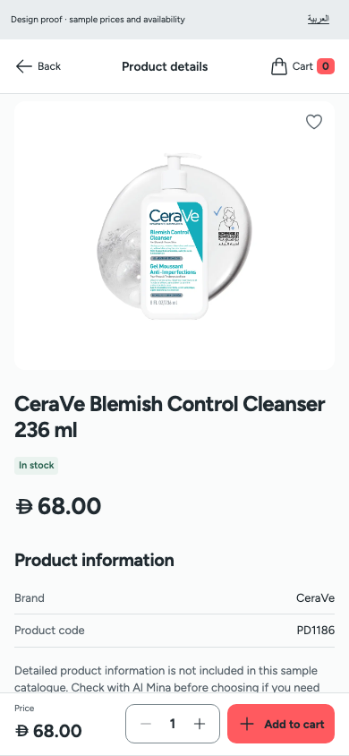
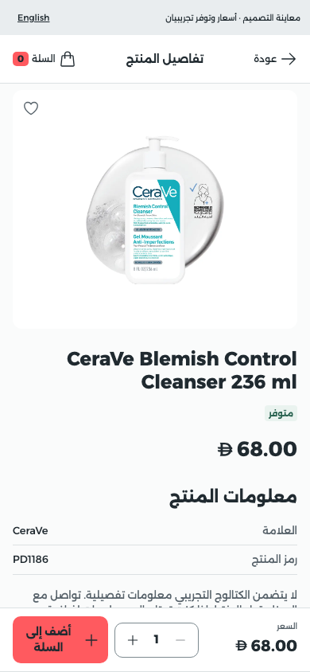

# P1-05 — owner selection and compact PDP correction

> Historical comparison evidence. The live proof routes and launch commands were retired in [P6-01](p6-01-retirement.md). Captures and the recorded screen decisions remain available.

> **Latest status:** Owner rejected the standalone toolbar; [N03 full-image PDP correction](p1-05-image.md) supersedes that preview. A/five and the shown supporting system remain selected. Read the latest correction for current review state.

17 November 2026; starting commit `00f9870`, clean branch `codex/storefront-pharmacy-app-reference`. **Owner choices recorded; corrected phone toolbar presented for review.** No final guide, production token or shared styling switch yet.

## Confirmed owner decisions

The owner's structured response to the [screen packet](p1-05-selection.md) selected:

1. **A — full-width campaign, five wide-screen home columns.** This supersedes our B recommendation. The proof now defaults to A/five; explicit comparison links remain available as review tools. Five is a wide-screen home choice, not a fixed phone/tablet rule or a five-column listing beside filters.
2. **Retain the shown supporting system:** Figtree/Alexandria, quiet near-white surfaces, dark text on coral actions and compact bordered cards; exact primary #FF5A5F remains confirmed. No second aesthetic vote required.
3. **Preview the compact phone PDP toolbar correction.** This authorizes building the correction; it does not record acceptance of an unseen revised screen. That correction is now implemented and captured below. Only this revised toolbar remains to review before P1-05 can close and P2 can establish the final system.

## Corrected phone PDP

[Open working product detail](http://127.0.0.1:4870/design-proof/products/sample--PD1186). Use the preview's language switch to see Arabic. [Selected home A/five](http://127.0.0.1:4870/design-proof?lead=full&columns=5).

- Mobile PDP replaces the logo/location/search/departments block and repeated breadcrumb with one compact toolbar: **Back · Product details · Cart count**. The actual product image begins directly below it; the existing save control stays in the gallery.
- Toolbar sticks while scrolling, preserves safe-area spacing hooks, uses real links and 44px minimum targets. Arabic reverses the return arrow and reading order. Desktop retains its full browse/search header and results breadcrumb.
- Back reuses the existing sanitized return URL and explicit query/scroll/focus restoration. Direct-entry fallback is the product listing. Cart continues to the actual gated cart; existing server-checked purchase dock, stock, quantities and factual product content are unchanged.
- Browse search remains prominent on home/listing. A desktop PDP search left open during resizing cannot hide phone PDP content when the desktop field becomes hidden. No new provider, share/scanner control or medical claim was added.

| Revised screen | English | Arabic |
| --- | --- | --- |
| Phone 390×844 | [EN](p1-05-toolbar/pdp-phone-en.png) | [AR](p1-05-toolbar/pdp-phone-ar.png) |
| Narrow phone 320×740 | [EN](p1-05-toolbar/pdp-narrow-en.png) | [AR](p1-05-toolbar/pdp-narrow-ar.png) |
| Desktop 1440×900, preserved composition | [EN](p1-05-toolbar/pdp-desktop-en.png) | [AR](p1-05-toolbar/pdp-desktop-ar.png) |

Original [pre-correction phone PDP](p1-05-selection/pdp-mobile-en.png) remains historical comparison evidence. [Six revised capture hashes/conditions](p1-05-toolbar/capture-manifest.json) identify the actual corrected screens. No reference device frame/watermark/claim copied.

## Verification and remaining boundary

- **17 proof interaction tests pass**: the existing 15 P1-04 flows plus two EN/AR toolbar regressions. Added assertions cover valid results return link, 44px toolbar targets, no overflow at 320/390/768, sticky position, desktop/phone switch, desktop-search-open → phone visible content, and cart navigation. Existing query/scroll/focus return, native browser Back, quantity/stock rejection, gallery family association and error recovery still pass.
- Root lint, web typecheck and fresh isolated production build `.next-verification-p1-toolbar` pass. Next 16.4.2 installed/bundled Link/navigation documentation consulted. No new dependency.
- Six fresh revised captures: both languages at 320, 390 and 1440. All HTTP 200, fonts/media settled, no document overflow/browser page errors. Direct rendered inspection checked phone/narrow/RTL and preserved desktop composition. Live Next compilation and browser-session checks are recorded with the checkpoint.
- Prior P1-04 existing-harness admin/checkout/responsive evidence remains valid for untouched shared consumers; that full harness was not repeated for this proof-only toolbar change. No order submitted or commerce/auth API/calculation changed. No production/provider access or deployment.
- Native keyboard/device/notch/screen-reader/zoom limitations and content/asset/shared-consumer obligations remain as recorded in P1-04. The prior independent review was not repeated; this correction uses automated and direct rendered inspection, not an invented independent sign-off.

Raw logs: `.verification-results/storefront-replacement/p1-05/toolbar-*` (ignored). Capture browser/test-owned servers closed; original 4860/4861 and proof 4870/4871 preserved. Restored generated next-env build noise.

**Next:** record the owner's acceptance or corrections for this concrete toolbar preview. Keep P1-05 `awaiting_review`, verified count 9/34, until that response. Then mark the phase gate complete and begin P2-01 without reopening the selected A/five/support-system choices. Deployment remains excluded.
