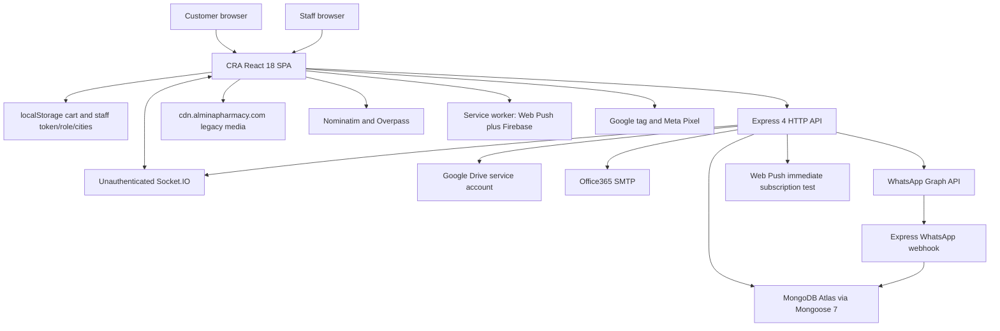

# Al Mina production modernization audit

Audit date: 2026-10-02. Repository: `nbl-ahmd/almina`. Local HEAD: `3d27241` (2025-11-24). Scope: repository audit and migration design; no application implementation, deployments, database access, data changes, credential changes, or history rewrites.

## Assessment and evidence limits

**The application represented by this checkout is not ready for a Next.js cutover. Security and commerce correctness need focused remediation in the existing API first.** Moving the frontend alone would preserve serious vulnerabilities and make them harder to distinguish from migration defects.

This report inspects all eight mounted API routers (49 method/path handlers), all nine Mongoose models, the frontend route table (44 active definitions) and request consumers, checkout/cart/order administration, media integrations, notification implementations, manifests/lockfiles, tracked credential files, and relevant Git history. Evidence references below use repository paths and current source line numbers. Findings describe source behavior; they do not assert that these exact routes are currently reachable in production or that credentials are still valid.

No production endpoint was probed. In particular, the API was not started: startup connects to the configured Atlas database and immediately pings an external service. No builds or browser sessions were run; neither frontend nor backend dependencies are installed. Compiled bundle size, Core Web Vitals, contrast, actual viewport rendering, deployment configuration, database contents/indexes, provider delivery, and production access controls remain unverified. A lockfile audit contacted the npm advisory service without installing packages or executing lifecycle scripts. Its results are dependency inventory findings, not proof of exploitability.

The baseline workspace already contained a modified `.DS_Store` and untracked `AGENTS.md`, `.agents/`, and `skills-lock.json`. They were not changed by this audit. Only migration documentation was added.

## A. Current architecture map



### Repository and execution

| Location | Current responsibility | Deployment implications |
|---|---|---|
| `frontend/` | CRA 5, React 18, React Router 6, storefront and both staff UIs in one application | Client rendering and client-loaded catalog; all route components imported eagerly |
| `backend/server.js` | Express, JSON/urlencoded parsing, permissive CORS, router mounting, HTTP/Socket.IO server | Persistent process assumed by `listen`, sockets and keep-alive interval |
| `backend/routes/` | Controllers containing validation, persistence, integrations and business logic together | No shared auth enforcement or service layer |
| `backend/models/` | Eight MongoDB/Mongoose models | Existing collection/model names and ObjectIds must survive |
| `backend/public/`, `backend/uploads/` | Local media remnants and temporary files | Public files served from relative working directory; disk persistence uncertain |
| Root `package.json` | Separate dependency set, including PM2, Novu and unrelated packages | Start runs `pm2-runtime start backend/server.js`; build installs root/backend dependencies but does not build frontend; no workspace declaration |
| Root `temp*.js` | Detached legacy/prototype code; `temp.js` attempts a Drive write | Not safe migration scripts; do not run |

The configured frontend API origin and backend keep-alive target are `https://almina-of4b.onrender.com`. Older Render origins remain in email templates and social metadata. This is evidence of intended Render use, not a verified hosting topology. The frontend public origin appears as both `alminapharmacy.com` and `www.alminapharmacy.com`; CDN routing and its underlying Cloudinary configuration are not in the repository. A Git commit describes Cloudinary migration, but current backend uploads still use Drive; do not infer that media migration is complete.

Both directories contain legacy Vercel configurations. The frontend config targets a root `index.js` that is absent, and uses `@now/node`; the backend wildcard Node build does not establish a working persistent Socket.IO deployment. The real production host/build commands, DNS, reverse proxy rules and active deployment commit require confirmation from deployment records.

Working-directory assumptions also matter: `dotenv.config()` loads `.env` from the process working directory, and `express.static('public')` is relative to that directory. Starting from the repository root via its PM2 command does not by itself load `backend/.env` or serve `backend/public`; injected platform settings or a configured cwd may compensate, but were not inspected. Package manifests do not pin a supported Node engine.

The connection string shape indicates Atlas already. A new database or collection relocation is not necessary merely to adopt Next.js. `backend/database/db.js` contains a local URI and is imported but not used for the live connection.

`MAINTENANCE_MODE` returns HTTP 503 HTML before Express routes/static files. It has no Retry-After header or health/webhook exception. `REACT_APP_MAINTENANCE_MODE` is compiled into CRA and replaces every frontend route, including admin, with a landing page. Neither flag's production value was checked. Maintenance is not an authorization boundary.

## B. Route map and user flows

Source: `frontend/src/App.js:169`. Paths written without a leading slash in the source are normalized below. Commented prototype routes are excluded.

### Storefront

| Route | Current component / behavior | Compatibility requirement |
|---|---|---|
| `/` | Home: banners, featured products, categories, deals, WhatsApp contact | Preserve shared entry URL and business links |
| `/products` | Product browsing, local category selection, incremental offset loading | Preserve browsing; move shareable filters/page state into URLs deliberately |
| `/search?q=…` | Same Products component, name/description search | Preserve query encoding and shared search links |
| `/productdetails/:id` | ProductDetails calls `/api/products/details/:id` | `id` is the `PD…` **business product_id**, not MongoDB `_id` |
| `/offers` | Sale product listing | Preserve promotion display conventions |
| `/categories` | Enabled category list | Preserve links and category visibility rules after correcting inconsistencies |
| `/categories/:categoryId` | Category metadata and product listing | `categoryId` is a MongoDB ObjectId; keep it valid |
| `/cart` | Persistent guest cart, quantities, totals | Preserve `cartItems` localStorage format through an explicit adapter/version migration |
| `/checkout` | Guest details, UAE location/city, delivery fee, card/cash on delivery | Preserve guest checkout and delivery payment methods |
| `/about` | Static pharmacy information | Preserve URL |
| `/contact` | Currently renders About-style copy, not a contact workflow | Repair content without losing URL |
| `/map` | Public Overpass suburb prototype | Preserve or explicitly retire/redirect after confirming usage |
| `*` | Client NotFound screen | New application must also send an actual HTTP 404 |

Current shopping flow: browse/search → product card or details → fetch store status → fetch product stock → store the supplied product data and quantity in localStorage → cart → checkout → POST order → browser renders confirmation email HTML and separately requests email delivery → cart is cleared and confirmation state is set. There is no customer account/login/history UI or online payment gateway in the inspected code. Customer data is embedded in orders; the `User` collection represents staff. Do not invent customer-account migration requirements or replace cash/card-on-delivery with online payment during framework migration.

### Pharmacy staff routes

These routes require localStorage token presence and role equal to `user` in the browser. There is no corresponding API authorization.

| Routes | Current purpose |
|---|---|
| `/admin`, `/admin/order` | Active orders |
| `/admin/orders/:OrderId` | Order detail, quantity edit, dispatch with bill fields, cancellation; parameter is order MongoDB `_id` |
| `/admin/productlist`, `/admin/productlist/search?q=…` | Pharmacy product list/search |
| `/admin/disabled` | Disabled products |
| `/admin/salelist`, `/admin/salelist/search?q=…` | Sales list/search |
| `/admin/outofstock`, `/admin/outofstock/search?q=…` | Out-of-stock list/search; search route uses a different list component |
| `/admin/dispatched`, `/admin/cancelled` | Order status lists |
| `/admin/categories/update/:id` | Standalone category editor |
| `/admin/productlist/update/:id` | Standalone product editor |

### Administrative routes

These routes require localStorage token presence and role equal to `admin`, also only in the browser.

| Routes | Current purpose |
|---|---|
| `/admin/login` | Public staff login; navigates based on returned role |
| `/admindash`, `/admindash/products`, `/admindash/products/search?q=…` | Administrative product list/search |
| `/admindash/outofstock`, `/admindash/outofstock/search?q=…` | Out-of-stock management |
| `/admindash/salelist`, `/admindash/salelist/search?q=…` | Promotion lists |
| `/admindash/categories`, `/admindash/categories/update/:id` | Category upload/list/edit |
| `/admindash/categories/search?q=…` | Currently renders Products_list, not a category search |
| `/admindash/uploadproduct` | Product and category upload |
| `/admindash/banner` | Banner management |
| `/admindash/settings` | Store open/closed toggle |
| `/admindash/batch` | CSV product import |
| `/admindash/users` | Staff creation/list/delete and city assignment; edit handler is a placeholder |
| `/admindash/whatsapp` | Conversations, posters, CSV recipient bulk messaging and live reports |

Preserve both role names and separate staff/admin workflows through a server permission mapping. Do not assume `admin` currently has inherited access to `/admin`: its client guard explicitly allows only `user`.

Standalone category update routes pass no `cat` prop even though Categoryupdate initializes from that prop and dereferences it (`Categoryupdate.js:7,54`). ProductUpdate receives `id` and `products` props from modal callers, but the standalone route supplies neither and the imported useParams is unused, so its fetch uses an undefined ID (`ProductUpdate.js:7,40`). Validate modal and direct-route flows independently. Preserve verified modal workflows while repairing direct links.

## C. API map and request/response contracts

Source mounts: `backend/server.js:64`. **All 49 handlers lack authentication/role middleware.** Public catalog reads, guest checkout and provider verification legitimately need some public access; staff mutations, PII reads and notification sending do not. CORS `origin: '*'` does not provide access control.

Error contracts vary between `{error}`, `{message}`, `{success}`, text and redirects; missing IDs sometimes return 500 and then attempt a second response. Most async routes are bare Express 4 handlers, so rejected promises are not consistently forwarded to the error middleware. Malformed JSON filters are parsed outside some try blocks.

### Authentication: `/api/auth` — `backend/routes/Login.js`

| Method/path | Request | Success response / current side effect |
|---|---|---|
| POST `/login` | JSON `{username,password}`; only nonempty checks | `{token,name,username,role,cities}`; JWT carries username with no expiry |
| POST `/signup` | JSON `{username,password,name,role,cities}` | `{message}`; creates bcrypt-hashed staff account with supplied role |
| GET `/users` | None | Full `User[]`, including password hashes and city assignments; unpaginated |
| DELETE `/users/:id` | MongoDB user `_id` | `{message}`; hard deletes account |

`verifyToken` is defined but never attached/exported for these routes. It expects the raw header token rather than standard Bearer parsing, does not reload user permissions, and uses a hardcoded signing secret. Frontend API callers do not attach an authorization header to protected operations.

### Products: `/api/products` — `backend/routes/products.js`

| Method/path | Request | Response / behavior |
|---|---|---|
| POST `/` | Multipart `images` up to 5; `name,price,stock,barcode,description,category,vat,sale,featured` | 201 `{message,product}`; generates PD ID, uploads 500×500 WebP to Drive, creates product |
| GET `/` | `filter` arbitrary JSON object, `limit`, `offset`, `disabledCat` | Populated `Product[]`; unbounded when limit absent/falsy; category visibility filtered after pagination |
| GET `/search` | `q`, `filter` JSON array, `limit`, `offset`, `disabledCat` | Populated `Product[]`; case-insensitive raw regex; filter array applied only in paginated branch |
| GET `/:id` | Product MongoDB `_id` | Unpopulated product; missing record uses 500 without return |
| GET `/category/:categoryId` | Category ObjectId | All category products populated; no visibility enforcement or pagination |
| GET `/details/:productId` | `PD…` business ID | `{product,relatedProducts}` populated; related list unbounded and visibility not enforced |
| GET `/images/:filename` | Legacy `image` or entry in `images` | Drive stream labeled WebP; supports scalar Drive ID and parallel ID array |
| PUT `/:id` | Multipart `images` up to 5; current code accepts only `name,price,stock,description` | Updated product; other form fields silently ignored; old Drive assets deleted before replacement succeeds |
| PUT `/publish/:productId` | MongoDB `_id` despite parameter name | `{message}`; toggles `disabled`, so retry is not idempotent |
| DELETE `/:id` | MongoDB `_id` | `{success,message}`; removes product and only scalar Drive asset |

The frontend sends `disabled=false` and `category` query parameters in some places, but the server does not use these directly. Actual product conditions come from `filter`. Search consumers often send standalone `disabled=false` without a filter, so product visibility is not reliably enforced. Public visibility must become a server rule, with separate authorized admin querying.

### Categories: `/api/category` — `backend/routes/categories.js`

| Method/path | Request | Response / behavior |
|---|---|---|
| POST `/` | Multipart `name`, optional `image` | 201 `{message}`; random color; original upload bytes stored in Drive under an opaque filename |
| GET `/` | Optional arbitrary JSON `filter` | Category array sorted by name; unbounded |
| GET `/:id` | Category `_id` | Category; missing record uses 500 without return |
| GET `/images/:filename` | Stored image filename | Drive stream always labeled WebP, even when source bytes were not converted |
| PUT `/disable/:id` | ID; accepts optional multipart image but does not use it | `{message}`; toggles `disabled` |
| PUT `/:id` | Multipart `name,color,image` | Updated category; deletes previous nondefault Drive file before upload/save |
| DELETE `/:id` | ID | Deletes record and nondefault Drive file, then references undefined `uploadDir`, which can produce failure after deletion |

### Banners: `/api/banners` — `backend/routes/banners.js`

| Method/path | Request | Response / behavior |
|---|---|---|
| POST `/` | Multipart `name,link,image` | 201 `{message}`; converts WebP, Drive upload/save; missing file processing happens before try block |
| GET `/` | None | Full banner array |
| GET `/images/:filename` | Filename | Drive WebP stream |
| DELETE `/:id` | Banner `_id` | `{success,message}`; hard deletion and Drive/local file removal |

Stored `link` is required, but the current BannerCard displays images without using the link. Preserve data even if its current UI consumer ignores it.

### Orders: `/api/orders` — `backend/routes/Orderrouter.js`

| Method/path | Request | Response / behavior |
|---|---|---|
| POST `/` | `{customer,cartItems,...}` where totals and customer payment/location are browser supplied | 201 full saved order; saves first, decrements stock afterward, emits global `newOrder` |
| GET `/` | None | Every order and full customer details; populates current products/categories; newest first |
| GET `/:id` | Order MongoDB `_id` | Full populated order; no ownership/city restriction |
| PUT `/edit/:orderId` | Entire arbitrary update body | `{message:'Order dispatched successfully'}` even for an edit; directly updates fields, no inventory reconciliation |
| PUT `/:orderId` | `{billno,billamount}` | Marks dispatched true, stores unverified bill data |
| PUT `/cancel/:orderId` | ID | Marks canceled true; no stock restoration or transition checks |
| POST `/email` | `{recipient,htmlContent}` | Sends arbitrary supplied HTML using SMTP; successful path never ends HTTP response |
| POST `/subscribe` | `{subscription}` including endpoint/keys | Sends one immediate Web Push notification; `{success}`; no subscription persistence |

The order schema stores `customer.name,mobile,email,emirate,city,payment,address,totalprice,totalSalePrice,totalAmount,deliveryFee`; optional building/flat/note/map/VAT; lines store only `{_id:ProductObjectId,quantity}`. Mongoose does not preserve the extra product snapshot fields sent by the current cart. The response is not the same as the browser's original full product array.

### Store and import

| Method/path | Request | Response / behavior |
|---|---|---|
| GET `/api/store/status` | None | `{status:'open'|'closed'}`; 404 if no record |
| PUT `/api/store/status` | `{status:boolean}` | `{message}`; upserts first matching record, maps boolean to string |
| POST `/api/store/cart/add` | Unspecified | Closed-store middleware returns 403; open-store handler has no response or cart logic; frontend does not use it |
| POST `/api/batch` | Multipart `file` CSV | `{success,count}`; reads entire CSV, creates missing categories then inserts products; no deduplication, bounded rows, transaction or cleanup |

CSV fields consumed: `name,category,vat,price,barcode,featured,sale,stock`; flags require literal uppercase `TRUE`. Single-product ID generation starts from 0; batch generation starts from 5000 and scans products. Preserve existing IDs rather than reassigning either range.

### WhatsApp: `/api/whatsapp` — `backend/routes/whatsapp.js`

| Method/path | Request | Response / behavior |
|---|---|---|
| POST `/image` | Multipart `image` | 201 `{message}`; stores poster in Drive, labels JPEG without explicit JPEG conversion, emits `newPoster` |
| GET `/image` | None | All poster records |
| GET `/image/:filename` | Filename | Drive stream labeled JPEG |
| DELETE `/image/:id` | Poster `_id` | Hard deletion plus Drive/local removal |
| POST `/s` | `{recipient,template,link}` | `{status,recipient}`; sends template with image header and `en_US` language |
| POST `/sr` | Arbitrary body | Uses first body key as recipient, logs it; returns unrelated product success message; no provider send |
| POST `/` | None | Sends configured-recipient demo text; redirects `/catalog` on success; missing failure response |
| POST `/text` | `{recipient,name,text}` | Provider text send, redirects `/catalog` on success; persists admin message independently of delivery; missing failure response |
| GET `/recipients` | None | Every conversation including all nested messages and names/numbers |
| GET `/messages/:recipient` | Sender number/string | Entire conversation |
| POST `/webhook` | Meta-style JSON | Saves first incoming message or status and emits global events; no signature check/replay dedup; status branch can respond twice |
| GET `/webhook` | `hub.mode,hub.verify_token,hub.challenge` | Challenge for matching verification token, 403 mismatch; no response when required parameters absent |

Outbound helper hardcodes Graph `v17.0`, phone-number identifier and bearer token instead of using corresponding environment settings. GET verification token checking does not authenticate POST webhook payloads.

### Realtime contract

Socket.IO is attached to the persistent HTTP server with wildcard origin and no authentication/rooms. Server-emitted events: `newOrder` (full saved order, including PII), `newMessage` (recipient, message, sometimes promotionStatus), `newPoster` (image filename), `newBroadcast` (recipient/status/error). These names and payload consumers need a compatibility adapter while access becomes scoped to authorized staff. Four frontend modules instantiate sockets at import time; eager App imports can establish connections even when the public storefront is being rendered.

Future contracts should use typed allowlisted requests, consistent errors, bounded pagination and explicit domain operations. Introduce them additively; keep old array responses and field naming in a transitional adapter for existing clients. Do not preserve unauthenticated privileged access as a compatibility feature.

## D. Database model and index map

All models use default Mongoose collection naming. Names below are inferred defaults; deployed collection names/indexes were not queried. Each has MongoDB `_id`; only three additional unique fields are declared in source. Schema declarations are not proof of installed indexes.

| Model → expected collection | Fields and references | Declared indexes / problems |
|---|---|---|
| `Product` → `products` | `product_id,name,images[],gdriveFileIds[],gdriveFileId,category→Category,featured,price,vat,stock,sale,disabled,barcode,salePrice,salePercent,saleBadge,saleType,description,createdAt` | No business-ID, barcode, category, visibility or sort indexes declared; Number money/stock have no lower/integer bounds |
| `Category` → `categories` | `name,color,image,gdriveFileId,disabled` | No name/visibility/image index; disabled has no default; default assets shared |
| `Order` → `orders` | `orderId,dispatched,canceled,billno,billamount,customer{…},cartItems[{_id→Product,quantity}],createdAt` | No unique orderId, createdAt/city/status index; no snapshots/version/idempotency key |
| `User` → `users` | `username,password,name,role,cities[],subscription` | username unique; password not excluded; role unrestricted String; subscription uses `tpe` typo |
| `Banner` → `banners` | `name,image,gdriveFileId,link` | No image lookup index or timestamps |
| `Store` → `stores` | `status:open|closed` | No singleton key/index; arbitrary first document updated/read |
| `Conversation` → `conversations` | `from,name,promotionStatus,messages[{content,timestamp,sender}]` | Both from and name unique; unrelated people sharing a name can fail; unbounded embedded messages |
| `whatsappBulkReport` → `whatsappbulkreports` | `broadcast[{messageStatus,error,errorDetails,recipient}]` | No campaign/provider message ID/timestamps or recipient index; arrays grow indefinitely |

Critical schema compatibility: legacy product `image` is still read across the app and image API but absent from the current Product schema. Scalar `gdriveFileId` remains. New arrays can be empty or not represent all legacy media. Old categories may lack `disabled`; queries for `disabled:false` and strict populated checks do not consistently include those documents. Do not equate a missing field with a confirmed publication choice without an inventory and approved policy.

Proposed indexes, after profiling actual requests and checking duplicates: unique `product_id` and `orderId`; nonunique barcode unless business uniqueness is confirmed; product visibility/category/sort compound indexes; image lookup indexes where legacy proxy remains; order city/status/createdAt/_id indexes; staff username; conversation sender; outbox due jobs; idempotency scope/key. Verify query plans on a representative isolated dataset. Do not run `syncIndexes`, drop indexes or install unique constraints before duplicate resolution is reviewed.

## E. Dependency cleanup list

Locked versions: CRA 5.0.1, React/React DOM 18.2.0; backend Express 4.18.2, Mongoose 7.0.5, Multer 1.4.5-lts.1, Sharp 0.32.1, Nodemailer 6.9.7; Axios 1.4.0 frontend / 1.7.7 backend. No Next.js dependency is installed or locked. Caret manifest ranges do not describe a reproducible upgraded deployment; review the lockfile.

Read-only `npm audit --json --package-lock-only --ignore-scripts` results on audit date:

| Lockfile | Low | Moderate | High | Critical | Total |
|---|---:|---:|---:|---:|---:|
| Root | 4 | 8 | 22 | 4 | 38 |
| Backend | 4 | 11 | 32 | 5 | 52 |
| Frontend | 15 | 25 | 53 | 9 | 102 |

Counts are package entries across overlapping trees, including build/dev dependencies, and must not be summed as unique vulnerabilities. Prioritize reachable runtime issues and protect the build pipeline too. The registry report did not list every known issue: independently checked Multer advisories confirm the locked version is affected by malformed-multipart DoS. The August crafted field-name crash advisory affects the locked 1.x version and is fixed in 2.3.0. A September disk-storage regression affects 2.2.0–2.3.x and is fixed in 2.4.0; this matters when selecting an upgrade, not as proof that this specific regression affects the existing 1.x lock. Select the latest stable fully patched release at implementation time and retest upload behavior. Sources: [Multer disk-write advisory](https://github.com/expressjs/multer/security/advisories/GHSA-3pph-fpjx-jg34), [Multer field-name advisory](https://github.com/expressjs/multer/security/advisories/GHSA-wc9g-mqfw-jrwm).

| Concern | Current duplication / usage | Recommended action |
|---|---|---|
| Build/router/SEO | CRA, React Router, Helmet, unused react-snap; backend prerender-node not wired | Keep legacy build until migrated routes work; retire each with replacement. CRA is deprecated: [React announcement](https://react.dev/blog/2025/02/14/sunsetting-create-react-app) |
| UI | MUI + Emotion, React Bootstrap, Bootstrap npm plus CDN alpha CSS/JS; Tailwind listed without evident build integration | Pick one component system and one styling approach after workflow preservation. Remove CDN/npm duplication and version drift; no simultaneous redesign required |
| Icons | MUI icons, Lucide, Remixicon, Bootstrap icons, Line Awesome, two Font Awesome delivery paths | Consolidate gradually; avoid font kits on storefront |
| Maps | Leaflet/react-leaflet prototype; Google Maps wrapper, Mapbox GL and SDK declared without source imports | Remove unconsumed Google/Mapbox dependencies after verification; choose at most one renderer if interactive maps are required. Current checkout primarily needs address/geocoding, not multiple map engines |
| Push | Web Push, browser Notifications, Firebase service worker; Novu frontend/root dependencies unconsumed | Establish one background-push lifecycle; retain scoped realtime alerts. Remove unused Novu after confirming deployments; preserve/re-enroll existing subscriptions deliberately |
| Email/image backend packages in frontend | Nodemailer and Sharp unimported; email render/components imported through guest CartProvider | Remove unconsumed server packages; move confirmation rendering/send to API after committed order |
| Request/fetch | Axios and fetch used; deprecated request imported unused; backend node-fetch only used by keep-alive | Remove request, choose a supported outbound client; keep browser-specific needs explicit |
| CSV | csvtojson used server, csv-parser unconsumed; PapaParse used for browser recipients | Retain bounded server import; remove unused parser. Browser preview may remain justified, server validates authoritative import |
| ID libraries | Backend uuid used; uuidv4/nanoid unconsumed; frontend imports uuid but does not declare it | Remove unconsumed libraries; declare direct dependencies while legacy remains; use atomic counters for business numbering |
| Other backend candidates | redis, socket.io-client/emitter, randomcolor, intersection-observer, @google-cloud/local-auth, @react-email/render, sharp-multer unconsumed; EXIF import unused | Remove only after verifying operational scripts/deploy usage; Redis package does not mean a cache/queue is implemented |
| Other frontend candidates | SWR, intersection-observer, dynamic virtual scroll, crop/resizer packages not imported in inspected source | Remove unconsumed packages; adopt one request cache only where needed |
| Root dependencies | `in`, `your`, `terminal`, unused `@novu/node`; PM2 no checked-in process config | Investigate accidental installs and lockfile supply-chain exposure; root manifest must reflect an actual workspace/deploy concern |

Audit flags include Mongoose injection/prototype-pollution, Axios, Sharp image decoding, Nodemailer, Socket.IO parser, and build transitive dependencies. `request` has no automatic fix in the audit; `react-scripts` suggested replacement `0.0.0` is not an acceptable migration. Never apply `npm audit fix --force` blindly or accept a downgrade solely to silence the report.

## F. Security findings (P0/P1/P2)

Severity here is operational priority: P0 = immediate containment before further migration; P1 = high-risk remediation before exposed production use/cutover; P2 = defense and reliability improvement. Reachability and credential validity require production verification; no exploit was sent.

| ID / severity | Current behavior and evidence | Impact | Required remediation |
|---|---|---|---|
| S01 **P0** | Git tracks `backend/.env`, service-account private key JSON, SMTP/Web Push secrets in `Orderrouter.js`, WhatsApp bearer in `messageHelper.js`; JWT secret hardcoded in `Login.js:8` | DB/provider takeover if credentials valid; token forgery; history retains exposures | Controlled rotation/revocation register below; secret store/config validation; ignore rules and history cleanup coordinated separately |
| S02 **P0** | No authorization on product/category/banner/import/store/order/user/WhatsApp mutations (`server.js:64`; all router signatures) | Unauthenticated price/stock/catalog/account changes, deletion and store closure | Authenticate each operation and enforce server permissions; update legacy clients to send real credentials in same release |
| S03 **P0** | Public signup accepts role/cities; public user list returns password hashes (`Login.js:58,95`) | Privilege creation, account enumeration, offline password cracking | Admin-only staff provisioning, role allowlist, safe user DTOs; review/reset exposed staff passwords through a documented process |
| S04 **P0** | Order totals copied from request, quantity unbounded and stock decremented unconditionally (`Orderrouter.js:69`; `Order.js:89`) | Arbitrary order value, stock inflation from negative quantities, overselling, partial writes | Server pricing/tax/delivery, positive integer quantities, stock condition and transaction/idempotency tests |
| S05 **P0** | All orders/conversations publicly readable; sockets broadcast PII to every connection (`Orderrouter.js:127`; `whatsapp.js:224`; `server.js:77`) | Customer identities, addresses, email, map location, purchase history and messages exposed | Protected paginated DTOs with staff city scopes; authenticated socket handshake/rooms, disconnect/revalidate revoked sessions |
| S06 **P1** | `/orders/email`, `/whatsapp/s`, `/whatsapp/text` and demo route publicly trigger provider sends | Spam, impersonation, provider cost/suspension | Server-generated order mail; privileged bounded messaging, recipient/template policy, quotas and consent enforcement |
| S07 **P1** | JSON filters passed directly to Mongo queries; raw regex with optional unlimited results (`products.js:352,419`; `categories.js:109`) | Query manipulation, disabled-item disclosure, database CPU/memory exhaustion | Explicit typed parameters, literal bounded search, page caps/time limits, indexed search; remove raw predicates from public contract |
| S08 **P1** | Memory Multer without byte/field limits, no file filter; public CSV import; vulnerable Multer/Sharp versions | RAM/disk/CPU exhaustion, malformed image processing, uncontrolled DB writes | Auth before upload parsing, request/bytes/pixels/rows/concurrency limits, actual format validation, patched codecs/parser, private temp storage and cleanup |
| S09 **P1** | POST webhook trusts arbitrary JSON; no HMAC/provider event IDs (`whatsapp.js:320`) | Forged conversations/status/consent, duplicates and replay | Verify signature against raw bytes with app secret; validate all batched events; dedup provider message/status IDs |
| S10 **P1** | `/orders/subscribe` sends to arbitrary subscription endpoint; no validation (`Orderrouter.js:49`) | Push relay abuse and potential outbound request/SSRF surface; not dynamically reproduced | Authenticated subscription registration with allowed endpoint policy/egress restrictions and persisted ownership, no public immediate send |
| S11 **P1** | JWT no expiry, no revocation/current-user check; browser owns role/cities; `notEmpty` is not string/object validation | Stale privilege, query-object risk, stolen token persistence | Typed bounded login, async bcrypt, login rate limits, revocable expiring sessions, server user/permissions lookup |
| S12 **P1** | SMTP `rejectUnauthorized:false` (`Orderrouter.js:104`) | Untrusted TLS certificates accepted for mail connection | Restore certificate validation and verify deployed Office365 transport |
| S13 **P1** | Runtime dependency advisories and open attack surfaces (section E) | Known request parsing/image/query/socket risks | Patch reachable dependencies individually and add focused regressions; isolate development/build risks |
| S14 **P2** | Logging raw webhook, conversations, edited orders, checkout/customer details and full upstream errors | PII and possibly token-bearing Axios config in logs | Structured redaction, request/event IDs, controlled retention and access |
| S15 **P2** | No centralized rate/body/schema enforcement, security header policy or explicit origin policy | Abuse harder to contain; weak browser defenses | Endpoint-specific limits, staged CSP/headers compatible with provider assets, documented allowed origins; authentication remains primary |

### Credential rotation/revocation register

**Every item below is required remediation, not an action performed by this audit.** Actual validity, account ownership and previous revocations are unknown. Record owner, new credential deployment, verification, old credential revocation, impact and completion evidence. Do not paste values into tickets or logs.

| Credential type | Tracked location | Required treatment / compatibility |
|---|---|---|
| MongoDB Atlas database credential | `backend/.env` (`MONGODB_URI`); tracked in multiple commits | Rotate DB password/principal, least privilege/network restrictions, roll all API instances to replacement before revocation; keep same data/collections |
| SMTP mailbox/app credential | `backend/.env` and hardcoded transport in `backend/routes/Orderrouter.js` | Rotate both exposed instances if distinct; determine which is active, preserve sender and delivery, audit mailbox abuse |
| WhatsApp/Meta bearer token | `backend/.env`, `backend/messageHelper.js`; six distinct hardcoded bearer literals found across helper history | Check/revoke all exposed historical variants, rotate active tokens, preserve business phone identity/templates/webhook URL; inspect provider activity |
| WhatsApp webhook verification token | `backend/.env` | Replace in provider and service together; separate from the new POST HMAC app secret |
| Google service-account private key | `backend/routes/cred.json`; private key field confirmed present | Replace/revoke exposed key, retain required folder permissions, verify all old image reads/uploads; do not delete media |
| Web Push VAPID private key | `backend/routes/Orderrouter.js` including comments | Rotate key pair; existing subscriptions tied to old public key need a controlled re-subscription rollout; do not promise silent continuity |
| JWT signing secret | `backend/routes/Login.js` | Replace with managed high-entropy secret; explicitly invalidate old staff sessions and communicate re-login; never retain verification trust in compromised key for convenience |
| Additional Google API key | `temp.js` | Identify owning project/permissions, rotate or revoke if active and restrict APIs/referrers; unrelated to public Firebase config |
| Staff password hashes | GET `/api/auth/users` source exposure | Review possible access history and require controlled password resets where exposure applies; not merely token rotation |

Firebase web API config in `frontend/src/firebase.js`, `config.js` and the service worker is public application configuration, not a service-account secret. It still needs correct API restrictions, project rules and quotas; do not label it a private credential or rotate it solely because it is browser-visible. [Firebase key guidance](https://firebase.google.com/docs/projects/api-keys).

Removing a file or adding `.gitignore` does not revoke a credential or remove its Git history. Rotation is the first protection; coordinated repository/history/artifact cleanup follows. A redacted pattern scan inspected 616 reachable historical text blobs across 179 commits, detecting credential assignments/private-key material and six distinct hardcoded bearer literals in helper history. Historical Firebase files contain additional public-config key variants. This is not an exhaustive detection of encoded secrets, unreachable objects, remote-only refs, CI artifacts or provider exports; a dedicated secret scan of those surfaces and provider access review remain required.

## G. SEO findings

| Finding | Evidence / current behavior | Future requirement |
|---|---|---|
| Client-only catalog and metadata | `public/index.html` contains root shell; Helmet updates after fetch; react-snap has no postbuild and prerender-node is unused | Server-render product/category HTML and metadata; verify source HTML and social preview without JS |
| Wrong product canonical | `ProductDetails.js:112` builds API-origin `/products/<MongoId>`, while actual route is storefront `/productdetails/<PD ID>` | Correct origin/path/identifier; keep original public route and add aliases/redirects only after URL inventory |
| Wrong catalog canonical | `Products.js:183–188` tests an array's truthiness, so empty browse state takes search metadata branch | Explicit browse/search state; encode queries; no placeholder product SEO |
| Static, inaccurate sitemap | Includes nonexistent `/products/categories`, cart/checkout and arbitrary search URLs; omits real product URLs and `/about`; duplicates contact slash form | Generate from published entities, approved canonical origin, real updated timestamps; exclude private/utility routes |
| No crawl policy for utilities | robots allows everything; no route noindex policy found | Noindex cart, checkout, admin and internal search; robots restrictions supplement, never replace authentication |
| Host/origin drift | www/non-www mixed; older Render image URLs and hashed logo build path | One canonical storefront origin, asset URL compatibility and explicit permanent redirects |
| Soft not-found responses | Client NotFound, product missing handled in UI; API sometimes 500 | Real 404 for missing entities; proper outage 503 plus Retry-After; distinguish removed product policy |
| Sparse semantics and structured data | Product name h5; category h6; no Product/Breadcrumb structured data found | Meaningful H1/headings; accurate Product/Offer/Breadcrumb data tied to server-authoritative display |
| Indexability state unknown | No Search Console, crawl results or HTTP deployment evidence inspected | Capture URL/indexing baseline, redirects, sitemaps and post-cutover coverage; do not assert Google currently has no index |

No ranking improvement or actual crawl status is claimed. SEO URL changes are optional; adopting App Router does not require slugging or changing product/category IDs.

## H. Performance, caching and data-fetching findings

| Finding | Current evidence | Migration response |
|---|---|---|
| Shared eager storefront/admin graph | `App.js` statically imports every page; no lazy route split; admin CSS/icons and import-time sockets reachable through graph | Server Components for catalog/static pages; isolated admin layout and interactive islands; measure route chunks |
| Heavy client checkout dependencies | CartProvider imports React Email renderer/template, mounted across shopping routes | Move email generation behind committed server operation; reduce browser serialization |
| Image path divergence | Legacy cards/banners use CDN; details/admin/new arrays use API→DB→Drive stream | Inventory before changing; CDN direct delivery with preserved aliases, validated renditions and appropriate cache headers |
| Wasteful image preload | ProductCard creates `new Image` for scalar/default CDN image even when rendered image uses another source | Remove redundant preload; prioritize measured LCP asset; dimensions and srcset |
| Hero lazy loading | BannerCard marks hero images lazy and shares one loading boolean across slides | First visible hero gets priority; avoid loading all slides; reduce motion controls |
| Large/static assets | Tracked slide ~696 KB; logo SVG ~542 KB; several duplicated images/audio | Optimize after inspecting visual fidelity and whether each is shipped; source bytes are not compiled gzip bundle bytes |
| Fonts and icon/CSS duplication | Four Google font families with multiple weights; external icon systems; mixed Bootstrap versions | next/font subset/weights; consolidate icons/styles and defer third parties deliberately |
| Unbounded collections/population | Orders/users/conversations/categories, category and related products; ID generation scans entire collection | Bounded DTOs, indexes, projections/lean where appropriate, cursor pagination, atomic counter allocation |
| Visibility filtered after pagination | `products.js:384` removes disabled categories after skip/limit | Apply publication rules in database query; current pages can look exhausted while matching items remain |
| Unstable pagination | Stock-sorted catalog changes after orders; offset slicing across concurrent changes | Define cursor/sort consistency; dedup IDs; clarify stock ordering behavior before changing it |
| Broken pagination state | Products and DealPage fetchProducts do not set terminal `loaded=true` for short/empty pages; category handlers reset offset but requests aren't canceled, allowing stale responses after filter changes | Correct end/cancellation behavior and accessible pagination/load-more; regression tests for empty/mixed categories |
| Repeat/network races | Per-route CartProvider remount, multiple fetch effects, no shared dedup/cache, no response cancellation for changing search/category | Stable storefront client cart boundary; server parallel reads where independent; bounded interactive cache and abort handling |
| Add-to-cart waterfall | Fetch store status then product stock; product passed to cart retains earlier price even after fetch | Authoritative server quote/checkout; responsive UX without treating preview stock as reservation |
| Checkout location dependency | Public Overpass query on every emirate change and Nominatim reverse geocode; no controlled timeout/cancel/cache/fallback city entry | Validated delivery-region data/fallback; preserve address text/map links; isolate external outage from ordering |
| Realtime scaling | Per-module connections; no disconnect/auth; order event refetches all orders | One authenticated connection per staff session, scoped invalidation; multi-instance adapter only when scale requires it |
| No active app cache strategy | SWR/Redis declared but unconsumed; service worker has push handlers only, no fetch/cache interception | Explicit cache matrix, not inferred library behavior |

Future cache matrix: static informational/catalog description data may have deliberate bounded cache/invalidation; price/stock/store-open decisions need current server validation at checkout; staff orders, conversations, authentication and customer details must not enter shared public caches. Catalog display can show previews with freshness semantics, but submission always revalidates. If using Next caches, include tenant/visibility/permission scopes as applicable and verify direct load, refresh and mutation invalidation on the exact patched framework version.

Bundle analyzer, compressed initial JS/CSS, route chunk sizes, Lighthouse/field LCP/INP/CLS and API percentiles were not measured. Record those before claiming performance wins. `reportWebVitals()` is called without an output callback; it does not establish a monitoring pipeline.

## I. Data-integrity findings

1. **Pricing is browser-authoritative.** Cart prices come from localStorage; salePrice truthiness selects discounts regardless of sale status. API accepts totals/VAT/delivery directly and does not validate current product publication, store-open status, minimum basket or supported payment/region. Customer/card-on-delivery values are not online payment confirmation.
2. **Quantity/stock integrity is absent.** No positive integer or maximum line validation, missing-product rejection or duplicate-line consolidation. `$inc` itself is atomic per product, but lacks `stock >= quantity` predicate, so concurrent valid requests can both overdraw stock. Negative quantities can increase stock; fractional quantities are accepted by Number schema. Invalid product updates can return null while order remains saved.
3. **Order and stock commit separately.** Order.create happens before parallel stock updates. One failure can leave an order with partial inventory effects and a 500 response, encouraging a duplicate retry. No idempotency key or transaction exists.
4. **Number allocation races.** Order ID scans all orders then returns max+1; product/batch do similar with inconsistent starting floors. No unique indexes. Parallel requests may allocate duplicates; deleting the highest record can permit number reuse. Preserve all existing business identifiers and use an atomic counter initialized safely beyond valid existing maxima.
5. **Order lines are mutable references.** Schema stores only product reference and quantity; reads populate current prices/names/categories. Product edits change historical display; deletion breaks populated lines. New orders require immutable identity/name/barcode/price/tax/discount snapshots. Historical facts cannot be reconstructed reliably from today's catalog.
6. **Edits/cancellations do not reconcile inventory.** Raw edits can replace totals/items/status/createdAt without stock deltas. Cancellation only flips a flag; dispatch and canceled can both become true. Restock policy is a business decision: define once-only inventory transitions, permitted edits and dispatch state before implementation. Do not automatically restock all historical cancellations.
7. **Money and VAT inconsistent.** Product and most totals are floating Number; totalprice is String. Frontend estimates VAT as 5% of displayed prices while stating prices include VAT and uses a separate tax-added calculation elsewhere. Whether stored prices are inclusive/exclusive must be confirmed; if inclusive, embedded VAT is price×5/105, not price×5/100. Preserve historical recorded totals; adopt explicit AED minor units/decimal arithmetic and approved rounding, not an automatic tax correction.
8. **Delivery policy conflicts.** Checkout uses 0 for all Ras al-Khaimah, 21 elsewhere (`Checkout.js:252`), while navbar policy says free within a 15 km radius and possible charges beyond it. Basket minimum AED 10 enforced only by browser. Owner must establish authoritative existing business policy; no migration should silently broaden/restrict service or alter fees.
9. **Catalog editor contract broken.** PUT accepts just four text fields plus `images`, while ProductUpdate/ProductEditPharmacy submit category, VAT, sale flags/prices/badges and scalar `image`. These can be ignored or rejected as unexpected upload field; zero/empty updates can be skipped depending on body representation. Cannot assume visible editor success means all fields persisted.
10. **Media writes can damage current assets.** Product replacement deletes old array files, including potentially shared defaults, before upload and database success. Category replacement has the same delete-first pattern. Product delete only cleans scalar ID, leaving array files. Partial failures create broken references or orphan media.
11. **CSV imports are repeatable writes, not idempotent migrations.** Reupload duplicates products, concurrent imports race IDs/categories, malformed/missing category causes processing failure, category side effects precede insertMany; partial failure leaves inconsistent artifacts. Uploaded CSV lives under publicly served storage and is not cleaned up.
12. **WhatsApp persistence is unreliable.** Unique person name rejects unrelated people; read-modify-save message arrays race; unbounded arrays approach document limits; only first webhook message/status handled; repeated events append repeatedly. Status records correlate by recipient, not provider message/campaign. Normal incoming messages reset promotionStatus to string `true`, so opt-out is not durable. Outbound bulk sends do not server-check opt-out and the browser loop doesn't await requests, producing a burst. Admin messages can persist despite send failure.
13. **Publication/singleton drift.** Category disabled missing defaults; mixed filters can hide old entities or disclose disabled ones. Store is not uniquely keyed and checkout does not enforce its status. Add explicit semantics without bulk rewriting legacy records speculatively.

Recommended checkout design: typed customer/delivery/payment and product IDs+quantities → load authoritative product data → normalize duplicate lines and validate availability/publication/store policy → compute exact quote → transactionally allocate order number, decrement stock conditionally, store immutable order and idempotency result, and enqueue notification outbox → commit → respond. Retries with same scoped key and same request return prior result; same key with different payload rejects. Notifications retry independently after commit and do not create another order. No new paid queue/service is required initially; a Mongo-backed outbox plus worker in the existing persistent API is enough if reliability and throughput tests support it.

## J. UI/UX, accessibility and responsive findings

This is a source review, not a rendered accessibility conformance verdict. Review criteria: [Web Interface Guidelines](https://raw.githubusercontent.com/vercel-labs/web-interface-guidelines/main/command.md). Positive baseline: responsive Bootstrap grids, labeled checkout inputs, product image alt text, some dialog components and product delete confirmation exist. Preserve those while addressing the following.

| Location | Finding / user effect |
|---|---|
| `frontend/src/context/cartcontext.js:193,262` | Checkout has no pending state/idempotency; failures are console-only; repeated clicks/retries can duplicate orders |
| `frontend/src/context/cartcontext.js:287` | Custom success overlay lacks dialog role, focus trap/restore and escape handling; close button is aria-hidden; clearing cart can navigate away before confirmation is perceived |
| `frontend/src/client/components/Checkout.js:96,130,346` | Shared formError can overwrite other validation errors; phone handler evaluates previous value; format accepts 10 digits despite +971 prefix; city/emirate/email error states not fully checked at submission |
| `frontend/src/client/components/Checkout.js:386` | Icon-only autolocation button lacks accessible name; permission/UAE failure can leave fetching state stuck because callback returns before reset |
| `frontend/src/client/components/Checkout.js:323` | Checkout inputs lack autocomplete/name metadata; errors need association and focus-first-error; submit uses button click outside native form validation |
| `frontend/src/client/components/navbar.js:79,109,130,152` | Icon close/clear/cart names missing or unclear; clickable delivery-policy div lacks keyboard semantics |
| `frontend/src/admin/login/Login.js:73` | Password visibility span is not a keyboard button; broken forgot-password template URL; no login pending state |
| `frontend/src/client/pages/ProductDetails.js:158,206` | Clickable thumbnails need buttons/keyboard states; quantity icon buttons need names; mouse-only zoom; name heading starts at h5 |
| `frontend/src/client/styles/index.css:256`; `frontend/src/admin/styles/dashboard.css:663` | Focus outlines suppressed with !important; test visible focus after cascade rather than assuming later styles compensate |
| `frontend/src/client/components/BannerCard.js:17` | Autoplay loop lacks pause/reduced-motion handling; slide image dimensions absent |
| `frontend/src/admin/components/ProductCard_admin.js:121` | Delete action is a clickable div; modal confirmation exists but trigger is inaccessible by keyboard |
| `frontend/src/admin/components/Categoryupdate.js:65` | Text/file fields lack labels; direct routes lack initial record loading; navigates before update resolves |
| `frontend/src/client/pages/Products.js:202`; `Categoryproduct.js:62`; `DealPage.jsx:95` | Empty data overlaps skeleton/loading state; network failure feedback weak; category changes and infinite-scroll end handling inconsistent |
| `frontend/src/admin/pages/OrderDetails.jsx:112` | Cancellation URL has a double slash, body/local state uses cancelled vs server canceled; verify route behavior and displayed status |
| `frontend/src/client/pages/Contact.js:10` | Contact route shows About content; staff user edit and other template links are incomplete |
| `frontend/src/client/styles/index.css:1056`; `navbar.js:192`; `Checkout.js:672` | Multiple fixed overlays/bottom navigation plus mobile order bar need device safe-area, keyboard, 200% zoom and short-height tests; occlusion is a runtime risk, not measured fact |
| `frontend/src/client/components/ProductCard.js:65`; `ProductDetails.js:128` | Image dimensions/loading errors not robust; product/category null assumptions can crash historical/deleted-reference records |

Required runtime review matrix: keyboard-only catalog/search/cart/checkout/admin; screen reader names/error announcements; 320/375/768/1280 px widths; portrait/landscape and virtual keyboard; zoom and long product/address names; reduced motion; declined notifications/location; slow/failing API and media. Preserve task completion before cosmetic redesign.

## K. Target architecture and App Router migration risks

```text
apps/
  web/                 Next.js 16 App Router, TypeScript
  api/                 Persistent Node/Express API, domain modules and workers
packages/
  contracts/           Runtime request schemas and TypeScript API/domain contracts
  ui/                  Shared verified components when genuinely reused
  config/              Shared lint/type/build configuration
scripts/
  migrations/          Versioned, resumable, dry-run-first additive migrations
  backfill/            Auditable entity normalization without silent commerce changes
  media/               Inventory/manifests/checksums, compatibility mapping
docs/migration/        Findings, decisions, validation and rollout status
```

On audit date, the official Next.js documentation identifies **16.3.8**, and the September 30 security release recommends it as patched Active LTS. No framework was installed here. Recheck the latest stable patched 16.x version, Node engine and matching React requirements when implementation starts; pin a reproducible lockfile and use its matching docs. [Next.js security release](https://nextjs.org/blog/september-2026-security-release), [CRA migration guide](https://nextjs.org/docs/app/guides/migrating/from-create-react-app).

Keep one API business-logic authority, existing MongoDB collections and a persistent Node host for Socket.IO, webhooks and notification outbox processing. Next handles presentation, server-rendered reads and narrowly scoped session/HTTP adapters; it must not duplicate pricing or inventory logic. Do not put long-lived sockets/cron timers into short-lived route handlers. Multi-instance socket adapter, separate worker deployment or external queue can follow demonstrated requirements rather than being prerequisites.

Use separate storefront and staff layouts. Product/category/informational pages are Server Components; interactive cart, search controls, checkout fields, map/location browser APIs and staff tools are Client Components as needed. Place guest cart state in a stable storefront boundary, not an app-wide provider enclosing server-only reads. Keep server-owned credentials in API/Next server settings, never NEXT_PUBLIC. Use next/image, next/font, Metadata APIs and loading/error/not-found conventions after verifying exact version behavior. Use domain DTOs to avoid passing raw Mongoose documents/dates/ObjectIds into client props.

### CRA/React Router → App Router compatibility risks

| Risk | Required handling |
|---|---|
| LocalStorage/window/navigator in initialization/render; `new Image` and module-level sockets | Isolate browser operations, guard boot/hydration, defer subscriptions to authenticated client lifecycle; adding use client alone does not make module import/render safe everywhere |
| React Router contexts and JSX stored in dashboard contexts | Replace with nested file routes/layouts incrementally; keep same URLs and workflow permissions |
| Params and query APIs | Verify installed Next 16 signatures; explicitly handle PD business IDs vs ObjectIds, query encoding, search state, trailing slash/case aliases |
| Provider lifetime | App Router layouts persist differently from current route-specific CartProvider; version stored cart and define hydration/synchronization, draft checkout survival and post-success behavior |
| Static assets and metadata | Replace CRA `%PUBLIC_URL%`, require-based image paths, Helmet and hashed logo references; preserve public filenames/manifest/worker URLs |
| CSS frameworks/Emotion | Preserve legacy styling first in isolated scope; validate SSR stylesheet order, dialogs and font/layout shift; retire duplicates per component |
| Cookie sessions/cross-origin API | Decide same-origin BFF/reverse-proxy contract, HttpOnly Secure SameSite and CSRF/origin handling; legacy staff callers need adapter; API independently authenticates every mutation |
| Environment behavior | CRA maintenance is build-time; API is runtime; define consistent Next runtime/build settings and server-only config validation |
| Caching/revalidation | Never statically export checkout/admin or cache personalized responses publicly; test stale stock, mutation refresh and cache partitions |
| Deep links/HTTP behavior | Explicit route-owned proxy switch; preserve reload/bookmarks/queries; correct HTTP 404/503; retain old SPA assets during rollout |
| Notifications and old clients | Root-scope service worker, old VAPID subscriptions, Socket.IO event names and deployed cached bundles must remain compatible or have explicit re-enrollment/version rules |
| Analytics | Current tag/Pixel initialization doesn't establish route-change tracking; avoid duplicated pageviews, preserve approved events while excluding customer data from URLs/telemetry |

Do not use a catch-all client SPA as the finished storefront architecture. It may support temporary coexistence but does not accomplish server rendering/SEO or solve API vulnerabilities.

## L. Ordered migration phases and exit gates

| Phase | Authorized future implementation concern | Exit gate |
|---|---|---|
| 0. Establish production baseline | Confirm active deploy/reverse proxy, owners, backup restore capability, existing data/index/media/URL inventory; preserve this audit | Reproducible sanitized staging dataset, deployment/credential register and recovery evidence |
| 1. Contain security exposure in legacy API | Rotate exposed credentials through owners; protected staff endpoints/socket rooms, remove public hashes/sending; coordinate legacy auth calls; patch reachable parsers/codecs; constrain filters/uploads/webhook | P0 closed and reachable P1 mitigated; unauthorized access tests; legacy workflows still pass |
| 2. Repair commerce in existing service | Server quote/policy, validated lines, conditional stock/transaction, idempotency, counter, immutable new snapshots, edit/cancel/dispatch rules, notification outbox | Concurrency/failure/retry regression suite passes; owner approves tax/delivery/cancellation policy; no silent historical changes |
| 3. Introduce web foundation | Next patched 16.x/TypeScript and contracts alongside CRA; secure sessions, build/lint/type/CI, observability, route proxy flags | Independent staging build/runtime and rollback; no broad production route switch |
| 4. Migrate low-risk storefront routes | About/contact/home/categories/products/details/offers/search in small groups; retain original IDs/URLs; metadata and media adapters | Direct navigation/reload/mobile/accessibility/API parity; source HTML SEO, link/redirect tests |
| 5. Migrate cart/checkout | Cart adapter and stable client boundary over already hardened API, old tabs/retries compatibility | Realistic staged end-to-end checkout, concurrent inventory, success/failure and delivery methods verified |
| 6. Migrate staff/admin | Preserve city dispatch/unassigned fallback, billing, catalog/CSV, store settings; corrected server permissions | Admin/staff capability and city matrix, old-record rendering, edit/cancel/dispatch tests; verified workflow replacement |
| 7. Complete integrations/media | Durable webhook/opt-out/status processing, provider adapter upgrade, background-push consolidation, validated CDN manifest | Replay/retry/reconnect/delivery and asset parity; subscription migration documented |
| 8. Progressive cutover | Route cohorts, cache isolation, domain/SEO verification, operational monitoring and incident drills | Sustained defined error/order/inventory/notification/SEO metrics within agreed baseline and rollback rehearsal |
| 9. Contract later | Remove replaced CRA routes/packages/fields only after compatibility and retention windows | No legacy readers/writers or missing media references; archived recovery artifacts and approved removal |

Security/integrity portions of integrations (signature/opt-out, unrestricted mail/push, delete-first media) belong in phases 1–2; phase 7 is their complete modernization, not permission to leave exposure until late. UI polish follows reliable workflows. Each phase should consist of focused reviewable commits and tested deployments, not one rewrite.

## M. Data migrations/backfills required

No migration was implemented or run. All future scripts need dry-run output, version/checkpoints, bounded batches, counts/checksums, audit provenance, compare-and-set writes and restart-safe behavior. Use expand → migrate → verify → switch → contract. Avoid transactions spanning long batch jobs; verify live-writing conflicts explicitly.

| Migration | Additive design / idempotency | Backward compatibility and rollback |
|---|---|---|
| Business-ID inventory/counters | Profile missing/malformed/duplicate PD/OD identifiers; preserve originals; initialize atomic counters above existing valid maxima under controlled writer handoff | Do not renumber history; any collision resolution needs explicit mapping; unique index only after reviewed remediation; counter never rewound |
| Order schema v2 for new orders | Add schemaVersion, status transition history, snapshots, currency/minor-unit totals and idempotency association; old fields still read | Keep existing order IDs/fields; old clients receive adapter; historical snapshots only from authentic historical source, otherwise record unknown provenance |
| Monetary representation | New explicit values derived from approved rules; backfill exact convertible values with source field/version and reconciliation report | Never recompute past final totals or discounts/tax from current products; ambiguous values quarantined for review; additive fields can be ignored on rollback |
| Inventory ledger/reservations | Introduce for new validated transitions; reconcile count/stock anomalies separately using approved operational evidence | Do not reset stock, infer historical decrements, or restock past cancellations; rollback must keep one compatible authoritative writer |
| Publication normalization | Profile missing disabled/sale/media fields; define backward-compatible read policy; fill only approved cases with absent-field predicate | Preserve currently intended visibility; record previous missingness; rollback uses adapter before removing anything |
| Media manifest | Map entity+legacy filenames+scalar/array Drive IDs to validated CDN assets with checksums/MIME/dimensions; copy before switch | Preserve old URLs and default sharing; partial reruns don't duplicate mappings; keep legacy files and switch reads back on failure |
| Staff permissions/session model | Add permission/city scope/session metadata; preserve bcrypt hashes, usernames, roles and IDs; fix subscription schema additively | Rotate compromised trust explicitly; map legacy role names; don't invent privileges, auto-reset all passwords, or expose hashes in reports |
| Store singleton | Read-only identify all store documents; approved canonical key and interpretation before unique constraint | Do not arbitrarily pick/delete records or change store status; old findOne behavior needs compatible adapter |
| WhatsApp identity/messages/status | Remove erroneous name uniqueness only after actual index verification and planned rollback; add provider IDs/campaign references; migrate messages with original IDs/timestamps/checkpoints | Keep sender numbers/names/text intact; preserve opt-out, including ambiguous status history for review; don't fabricate provider IDs |
| Consent | Add stable opt-out/consent provenance separate from raw button/status strings; unknown is not promotional permission | No bulk setting existing customers to opted-in; server send policy must honor opt-out during coexistence |
| Push subscriptions | Owned persisted records with endpoint uniqueness, key version and expiry/failure cleanup | VAPID rotation requires re-enrollment; browser is part of migration, cannot solve by DB backfill alone |
| Outbox/dedup records | Add durable notification jobs/event dedup with unique keys and retry state | Do not re-email/re-message every historical order; activate only committed new eligible events; dedup TTL must match replay/retention needs |
| Query indexes | Build bounded reviewed indexes based on explain plans; duplicate checks and staged creation | No syncIndexes/drop automation; removing indexes on rollback is usually unnecessary and requires its own assessment |

Data quality checks before implementation: missing referenced products/categories, stale image fields and array pairing, invalid/negative/fractional stock/quantities, order totals formats, duplicate business IDs/barcodes, contradictory statuses, unassigned-city semantics, missing fields, consent histories and oversized conversation documents. These are checks to perform against an authorized read-only production snapshot, not claims about actual counts.

## N. Production rollout, operations and rollback strategy

### Operational risks observed

- No checked-in CI workflows, Docker/process infrastructure, migration runner, API health/readiness endpoint, error monitoring or backup/runbook evidence. Root PM2 dependency is not a process configuration. External platform automation may exist; it was not inspected.
- Backend production start is `nodemon server.js` while nodemon is a dev dependency; an omit-dev install can fail, and production watching is inappropriate without an explicit reason.
- HTTP server starts without awaiting MongoDB readiness; connection errors are logged and service continues. Unknown routes become generic 500. The keep-alive pings `/`, which normally falls into that 500 handler; it is not a health check.
- Maintenance globally blocks webhook HTTP routes and public assets; frontend build flag can diverge from API state. No documented retry/draining semantics, graceful shutdown or job ownership.
- Socket state/rooms and outbound work are process-local; horizontal scale without deliberate persistence/coordination can lose notifications or deliver inconsistent events.
- Failed media deletion/upload, missing-file handling, unhandled async rejections, no bounded provider timeouts and HTTP success paths without responses create uncertain user outcomes.
- Raw provider/PII logs, third-party analytics on shared app shell, absent action audit logs and no retention policy impede incident assessment. No payment gateway reconciliation is needed for inspected delivery payments, but bill/order/stock reconciliation is essential.

### Rollout sequence

1. Establish current production commit/config and pin known-good artifacts for both applications. Confirm Atlas backups and rehearse restore to a **separate** environment, plus image inventory recovery. Agree RPO/RTO, alert thresholds and an accountable rollback owner before switching traffic.
2. Apply security and commerce patches to the API while the CRA storefront/admin still serve users. Deploy the legacy client authentication adapter together with protected endpoints; avoid a window of public access or unusable staff tools. Expired/compromised staff sessions require explicit re-login.
3. Build sanitized staging with separate Atlas database, media destinations and provider sandboxes/stubs. Prohibit live credential inheritance. Validate all regression suites, API contracts, schema compatibility and migration dry runs. Do not send test mail/messages to production customers.
4. Add fields/indexes before readers depend on them. Backfill only reviewed data with restart-safe conditions. Maintain compatible legacy response adapters and test both old/new deployed bundles. There must be a single authoritative checkout/inventory writer; never dual-write orders to old and new systems.
5. Introduce Next behind explicit route ownership/proxy flags. Roll out informational/catalog routes first. Preserve hostnames/IDs/queries and old JS/assets; keep untouched routes in CRA. Use read-only comparison/shadowing for catalog, never duplicate mutating checkout requests.
6. Switch cart/checkout only once the hardened shared API is stable. Test in-progress old tabs, mixed bundles, retry after timeout and idempotency. Do not cache `/api/orders` or personalized SSR in CDN. Verify service-worker scope and key transition without flushing guest carts unnecessarily.
7. Migrate staff workflows in limited cohorts after server city/RBAC parity. Preserve legacy UI fallback and allowlists, but no insecure legacy API bypass. Socket credentials/event scoping and notification retries must work through reconnect/deploys.
8. Monitor route errors, transaction failures, duplicate/rejected IDs, idempotency hits/conflicts, negative stock anomalies, reconciliation deltas, notification retries/provider failures, webhook lag/dedup, media 404s, staff task completion, latency and SEO status/canonical changes. Define release-stop thresholds from baseline, including immediate stop for confirmed authorization bypass, incorrect order total or partial stock commit.
9. Retain legacy assets, data fields and media until monitoring, workflow acceptance and an agreed observation/retention window pass. Only then contract/remove, in independent reviewed changes.

### Rollback rules

- Route/UI rollback changes proxy/feature flags to the verified CRA artifact using the **hardened compatible API**. It must never restore an API with public PII, compromised credentials or unsafe checkout.
- API rollback targets a prevalidated compatible safe release. Additive new fields/indexes remain; no production snapshot restore over post-cutover live orders. If no safe earlier writer supports new data, stop new checkout through an explicit gate and forward-fix/reconcile rather than enable a corrupting old writer.
- Drain in-flight transactions and let durable outbox/idempotency records prevent duplicate notifications/orders. Keep counter high-water marks and committed order records; do not decrement counters or replay customer submissions.
- Media rollback switches manifest/read selection to retained old assets. Never delete old assets during rollout; preserve URLs and shared defaults.
- Credentials stay rotated. A rollback is never a reason to reinstate a revoked key or trust old JWT signatures. Config compatibility must be in the rollback artifact.
- Provider webhook URLs/version/subscription transitions require coordinated rollback and replay policy. Do not run two active senders; exactly-once external delivery may be unattainable, so use stable dedup IDs/provider idempotency where supported and document remaining failure windows.

## O. Testing and verification strategy

Current tests: one stale CRA test expecting “learn react”; backend test command deliberately fails; root has no meaningful suite. Testing-library packages and Puppeteer config are not proof of coverage. Existing test imports App and can initiate module-level sockets, so future tests must stub network before imports. No tests/builds were run in this documentation-only audit.

| Layer | Required tests / release evidence |
|---|---|
| Business unit | Exact money rounding, sale eligibility, approved VAT/delivery/minimum rules; quantity/domain validation; status transition policy; no client total authority |
| API contract | Existing/new DTOs, array/pagination compatibility, validation errors, malformed IDs/filter JSON, missing entities, disabled categories/products, provider timeouts and complete HTTP responses |
| Auth/RBAC | Unauthenticated → 401; unauthorized role/city → 403; signup admin-only; no hashes in any response; expired/revoked/deleted-user session; city unassigned fallback; socket room isolation/revalidation; cross-origin/CSRF session policy |
| Checkout integration | Isolated Mongo replica set/transactions: many buyers of last unit; duplicate lines; zero/negative/fractional/huge quantities; disabled/missing items; changed price/stock; concurrent counters; same idempotency key after timeout; conflicting key payload |
| Atomic failure injection | Fail between order/counter/stock/outbox steps; transaction rolls back fully; notification failure never rolls back/recreates a committed order; same request retry returns one result |
| Order lifecycle | Edit quantity delta with stock limits, repeated cancellation once-only policy, dispatch vs cancel race, bill validation, archived product historical snapshots, legacy records without new fields |
| Import/media | Large/malformed/aborted multipart, MIME/content/pixel limits, missing file, CSV validation/dedup/resume/cleanup; replace-upload failure retains old image; shared defaults not deleted; checksums and all scalar/array/CDN URL variants |
| WhatsApp/email/push | HMAC raw-body verification, forged/replayed/batched events, same sender/name conflicts, consent never reset, campaign/message correlation, bounded sends, provider errors, outbox retry/dedup, mail recipient/template authority, VAPID re-enrollment and revoked subscription cleanup |
| Browser end-to-end | Public route direct load/reload/back/forward, share URLs, guest persisted cart and checkout error/success, cash/card-on-delivery, location denial/fallback, two-tab/cart state, staff login/role/city tasks, dispatch/edit/cancel/billing, old/new bundle coexistence |
| Accessibility/responsive | Keyboard/screen reader/error focus/dialogs, named controls, zoom/mobile keyboard, fixed bars, image failures/long strings, reduced motion, denied permissions, device viewport matrix from J |
| SEO | HTML title/canonical/OG/product content without JS, valid product/category links, live published sitemap only, noindex utilities, real 404/503/Retry-After, old-ID redirects, www normalization and encoded queries |
| Performance/load | Route bundle/asset budget, LCP/INP/CLS, indexed explain plans, capped queries, checkout concurrency, socket reconnect/fanout, outbox lag and upload resource limits; all load testing uses staging |
| Migration/recovery | Dry run → apply → rerun same result; interruption/resume; concurrent-write protection; row counts/reference parity/provenance; safe frontend/API/media rollback and separate-environment restore drill |
| CI/CD | Reproducible npm ci, supported engines, typecheck/lint/unit/integration/build, isolated browser/runtime checks, credential scanning and dependency advisories, protected deploy gates, immutable artifacts, staging promotion and production smoke monitors |

After any future Next change, use running `next dev` diagnostics plus browser verification, then production build/runtime checks as appropriate. Static typechecking alone cannot verify SSR/hydration, routes, network or cached user data isolation. Production checks must be explicitly non-mutating or use an approved synthetic process; never create or delete real customer orders as an audit test.

## Final priority list

### MUST FIX BEFORE MIGRATION

- Contain unauthenticated privileged APIs, public password hashes/order/message PII and global unauthenticated socket broadcasts.
- Rotate/revoke every exposed credential through a documented owner-controlled rollout; establish safe staff re-login and push key transition.
- Close public messaging/upload/query abuse and unsigned webhook ingestion; patch reachable vulnerable parsers/codecs/dependencies.
- Implement and test authoritative pricing/delivery/tax, positive quantities, concurrency-safe atomic stock/order writes, idempotency and numbering; approve existing ambiguous commerce policies.
- Establish production deployment/data/media/URL baseline, isolated regression environment, backup/restore and safe rollback evidence.

### MUST FIX DURING MIGRATION

- Preserve users/password compatibility, all product/order IDs/history, guest carts, existing public URLs, city dispatch semantics and payment/integration contracts through adapters.
- Add new order snapshots/explicit money/status/outbox data without inventing historical facts; validate additive backfills/indexes and media parity.
- Migrate routes incrementally onto latest patched Next 16.x with TypeScript/server rendering, explicit browser boundaries and safe session/cache handling.
- Correct canonical/sitemap/status codes, broken admin/API form contracts, checkout feedback/accessibility and direct-route behavior before their route switches.
- Add regression/CI/runtime/observability gates; consolidate notification lifecycle and preserve provider/webhook/push continuity.

### CAN BE DONE AFTER CUTOVER

- Broader visual redesign, optional slug URLs, advanced merchandising/search and nonessential map features.
- Further bundle/icon/font/style cleanup after migrated routes meet release budgets; remove obsolete legacy packages/fields/media only after usage and retention verification.
- Additional worker/service/cache infrastructure or horizontal scaling based on measured demand; avoid premature microservices.

These priorities do not permit deferring an exposed security issue, commerce correctness defect, inaccessible core task or unmet compatibility requirement until after cutover.
